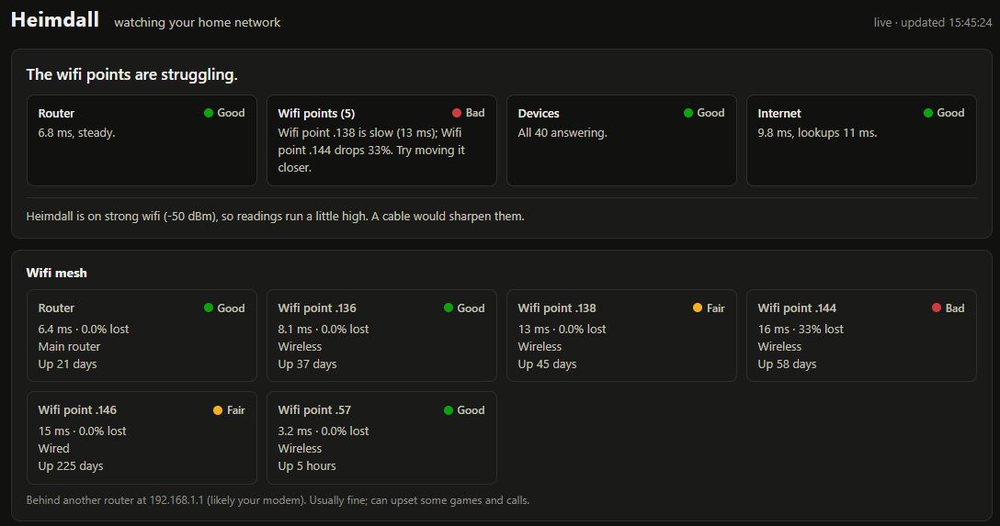

# Heimdall

**Is it the wifi, the router, or the internet?** Heimdall is a small, always-on
dashboard for your home network that answers that in plain English.



Run it on any Linux machine at home, open `http://heimdall.local:8765` from your
phone, and you get:

- **A verdict**: one line each for the router, wifi points, devices and the
  internet, saying which one is to blame when things lag
- **Wifi mesh**: every Google / Nest Wifi unit, with response time, uptime,
  restarts and how it joins the mesh
- **Devices**: everything switched on, grouped by type, with its maker and how
  quickly it answers. Phones and gadgets that nap to save battery aren't flagged
  as slow
- **Live lines**: response time of the router, wifi points and internet over the last hour
- **Comings and goings**: devices joining, leaving and restarting
- **A speed test**, on demand

It's one Python file and one HTML page. No packages to install, no accounts, no
cloud. Nothing leaves your network except pings and a few website lookups (DNS) to check
the internet is up.

## Quick start

You need Linux with Python 3.11 or newer (Ubuntu 24.04+, Debian 12+, Raspberry
Pi OS Bookworm). On Ubuntu or Debian, these extras give it device makers, wifi
details and the `heimdall.local` name:

```sh
sudo apt install ieee-data iw avahi-daemon python3-dbus
```

Then:

```sh
git clone https://github.com/anipatke/heimdall.git && cd heimdall
python3 server.py
```

Open **http://heimdall.local:8765** from any device at home, or the address it
prints. It finds your router and network by itself. The first scan for devices
takes about a minute.

If the page won't open from other devices but works on the machine itself, a
firewall is in the way. `./install.sh` below sorts that out for ufw.

### Keep it running

```sh
./install.sh
```

This installs a systemd service that starts at boot and restarts if it stops.
Heimdall runs as you, not root. sudo is only used to install the service and, if
ufw is on, to let devices at home (and nothing outside) reach the dashboard.

Logs: `journalctl -u heimdall -f`. Remove it all: `./install.sh --uninstall`.

**Want plain `http://heimdall.local`, without `:8765`?** If nothing else on the
machine uses port 80, set `port = 80` in `heimdall.toml` and run `./install.sh`.
If something already does, give Heimdall its own address. Pick one that's free
and outside the range your router hands out:

```sh
./install.sh --address 192.168.1.10
```

### Where to run it

Use a machine plugged into the router by cable: a spare laptop, a mini PC or a
Raspberry Pi. It works over wifi, but then every reading includes Heimdall's own
wifi hop, and the dashboard says so.

## Settings

Everything is optional. Copy `heimdall.example.toml` to `heimdall.toml` and
change only what you need:

| Setting | Default | What it does |
|---|---|---|
| `port` | 8765 | Port the dashboard listens on |
| `host` | all addresses | Listen on one address only |
| `mdns_name` | `heimdall.local` | Name other devices find it by; `""` turns it off |
| `mdns_ip` | this machine | Address that name points at |
| `router` | detected | Your router's address |
| `network` | detected | Address range to look for devices in (up to 1024 addresses) |
| `device_every` | 60 | Seconds between checks of known devices |
| `sweep_every` | 600 | Seconds between sweeps for new devices |
| `dns_names` | a few big sites | Names used to time website lookups |
| `[checks.internet]` | Cloudflare, Google | Servers that stand in for "the internet" |
| `[[kinds]]` | | Your own rules for naming device types |

Environment variables `PORT`, `HOST`, `ROUTER`, `MDNS_NAME` and `MDNS_IP`
override the file, and `HEIMDALL_CONFIG` points at a different settings file.

Devices are named from what they call themselves on the network. If yours show
up as "Unknown", add a `[[kinds]]` rule. For example, `match = "^living-room"`
with `kind = "TV"`.

## What it does to your network

Heimdall is meant to stay on, so it's deliberately light: about 7 small pings a
second in total, a few kbit/s.

| Check | How often | Traffic |
|---|---|---|
| Router, wifi points, internet | every second | 1 ping each |
| Website lookups | every 5 s | 1 lookup |
| Known devices | every minute | 3 pings each, 8 at a time |
| Sweep for new devices | every 10 min | 1 ping per unused address |
| Wifi mesh status | every minute | 1 small request per Google / Nest unit |
| Dashboard page | every 2 s (5 s on phones) | only the new readings |

The speed test downloads 25 MB from Cloudflare, so it briefly uses your whole
connection. It only runs when someone presses the button.

## Privacy

Heimdall sees which devices are switched on, when they come and go, who made
them and how quickly they answer. It can't see what they do online or how much
data each uses; your router keeps that to itself.

Readings are kept on the machine running Heimdall, in `log.csv`, `devices.csv`
and `state.json` next to `server.py`, and never sent anywhere. Each log is
capped at 100 MB. When it fills up it's renamed to `.old`, replacing the
previous one, so the logs never take more than about 400 MB.

The dashboard has no login. Anyone on your home network can open it and see
your device names. Don't expose it to the internet.

## Limits

- **Linux only.** It relies on the `ping` and `ip` commands, with Python 3.11+
  (`ping` from iputils, as on Ubuntu, Debian and Raspberry Pi OS)
- **Mesh details need Google / Nest Wifi.** With other routers you still get the
  verdict, devices and pings, just not the per-unit status panel
- **Phones are hard to identify.** Most use randomised "private" wifi addresses,
  which can't be traced to a maker; they're named from what they announce instead
- **IPv4 only**

## Troubleshooting

| Problem | Try |
|---|---|
| `heimdall.local` doesn't open | Use the address it prints. Check `python3-dbus` is installed and avahi is running (`systemctl status avahi-daemon`). Some older Android phones don't support `.local` names |
| Works on the machine, not from other devices | A firewall: run `./install.sh`, or allow the port yourself |
| "Couldn't find your router" | The machine has no default route. Set `router` in `heimdall.toml` |
| Devices show no maker | Install `ieee-data` |
| Everything looks slow | Is Heimdall on wifi? Check the note under the verdict |

## How it works

Two files, standard library only:

- **`server.py`** runs a handful of background threads (pings, DNS timing, device
  scans, mesh status) and serves the page plus a `/data` endpoint the page polls
  for new readings
- **`index.html`** is the whole dashboard: plain HTML, CSS and JavaScript with
  hand-drawn SVG charts, no build step

Common things to change when forking:

- **Device types**: `KINDS` and `VENDOR_KINDS` near the top of `server.py` map
  network names and makers to types
- **Other mesh systems**: `mesh_loop` reads each Google / Nest unit's local
  `/api/v1/status` page. Another router's status page could be read there in the same way
- **What counts as slow**: the `{ good, warn, bad }` thresholds (in milliseconds)
  in `render()` in `index.html`

## License

MIT
